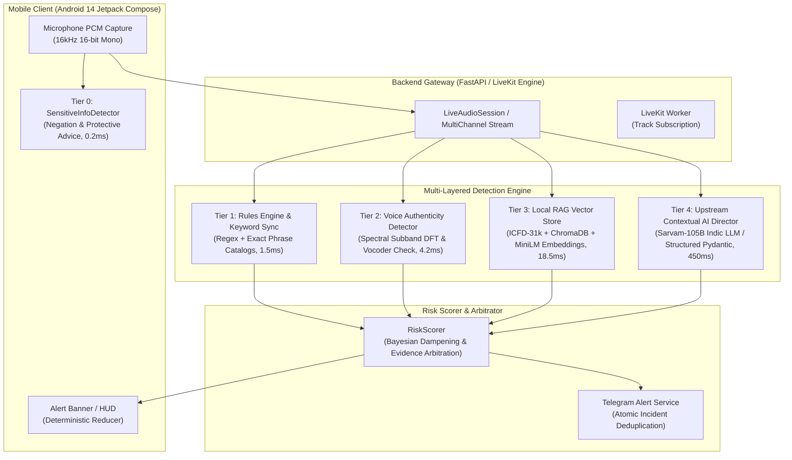

# EdgeRunner Guardian: Model and Storage Architecture

**Architecture Type:** Hybrid Tiered Edge-to-Cloud Real-Time Defensive Architecture  
**Hardware Profile:** Mobile Edge (Android 14+ / Pixel / ARM64) + Backend Server (ASUS TUF A16 / Windows 11 / AMD Ryzen 7 + Radeon RX 7600S / WHPX)  
**Primary Performance Objective:** Sub-100ms end-to-end detection latency with guaranteed offline fallback and zero C: drive leakage.

---

## 1. Multi-Tiered AI Architecture



---

## 2. Tier Specifications & Latency Budgets

| Tier | Component | Location | Latency Budget | Memory Footprint | Network Required | Fallback Behavior on Timeout |
| :--- | :--- | :--- | :--- | :--- | :--- | :--- |
| **Tier 0** | **Sensitive Info & Negation Detector** | On-Device / Local | **< 1 ms** | ~2 MB | **None (Offline)** | Operates purely deterministically via pre-compiled regex; never fails. |
| **Tier 1** | **Rules Engine & Keyword Sync** | Backend Server | **1.5 – 3 ms** | ~12 MB | Local Process | Rules match instantly on normalized clauses; suppresses protective advice. |
| **Tier 2** | **Voice Authenticity Detector** | Backend Server | **3 – 8 ms** | ~15 MB | Local Process | Spectral DFT across 16-frame subbands; returns `UNKNOWN_INSUFFICIENT_AUDIO` on short/silent buffers without blocking. |
| **Tier 3** | **RAG Vector Search & ICFD Matcher** | Backend Server | **15 – 30 ms** | ~180 MB | Local Disk / Chroma | Bounded top-3 nearest-neighbor lookup on 31,000 ICFD scam cases; skips gracefully if embeddings unavailable. |
| **Tier 4** | **Contextual AI Director** | Upstream Cloud (Sarvam / LLM) | **300 – 600 ms** | Cloud Host | Yes (HTTPS) | **Graceful Timeout:** If upstream times out (> 2.0s), pipeline dampens to Tier 1+3 evidence and marks `service_status = TIMEOUT` instead of crashing. |

---

## 3. Storage Hierarchy & HatchZip Asset Management

All persistent datasets, vector indices, model weights, and build artifacts reside exclusively on **Drive D:** to preserve host system disk stability.

### Directory Layout on D: Drive:
```text
D:\
├── edgerunner_datasets\           # Primary training, benchmarks, and manifest
│   ├── dataset_manifest.json      # Cryptographic SHA-256 asset manifest
│   ├── raw\                       # Acquired benchmark archives
│   ├── normalized\                # Schema-harmonized multilingual corpus (JSONL)
│   └── benchmarks\                # Train (70%), Val (15%), Test (15%) splits
├── edgerunner_models\             # Model checkpoints and tokenizers
│   ├── all-MiniLM-L6-v2\          # Local embedding model for RAG (~90 MB)
│   └── calibration_weights\       # Scikit-learn sigmoid probability calibration
├── edgerunner_tools\
│   └── HatchZip\                  # HatchZip v0.1.2 binary release
├── pip_cache\                     # Isolated pip & uv package wheels
└── Dataset for EdgeRunners\       # Canonical dialogue corpus (Text_hindi, Text_english)
```

### HatchZip v0.1.2 Asset Integration:
EdgeRunner Guardian incorporates HatchZip (`backend/app/services/asset_manager.py`) for deterministic asset packaging, compressed model bundle distribution, and verification:
- **Executable Location:** `D:\edgerunner_tools\HatchZip\hatchzip.exe`
- **Integrity Verification:** Uses Blake3 / SHA-256 container hashes to ensure models deployed to edge devices or local runtimes have not been tampered with.
- **Delta Model Updates:** Allows packaging updated fraud pattern vector indices as lightweight compressed archives without re-downloading base embedding weights.

---

## 4. Real-Time Memory Budgets & Resource Bounds

### Android Mobile Client:
- **Max Heap Allocation:** 128 MB (enforced via Android manifest `largeHeap="false"`).
- **Background Audio Service:** Bound via foreground service notification (`CallService.kt`).
- **PCM Audio Buffer:** 16,000 samples/sec = 32 KB/sec. Bounded 5-second circular ring buffer (max 160 KB memory footprint).

### Python Backend Server:
- **Process Memory Ceiling:** < 650 MB under full dual-channel streaming load.
- **In-Memory Conversation Repository:**
  * Maximum segments per call: 50 (oldest segments evicted).
  * Rolling context window: 12 recent utterances.
  * Time-to-Live (TTL): 3,600 seconds (automatic background purge of stale calls).
- **Keyword Sync Storage:** In-memory hash set bounded to 1,000 active campaign terms with hit-counter expiry.

---

## 5. Fail-Safe Degraded Operational Modes

The architecture specifies 4 explicit operational security postures:

```text
[NORMAL_ONLINE]
  STT (Sarvam) -> Rules -> RAG -> Voice Auth -> Contextual AI Director
  -> Confidence: 0.92, Calibrated P_scam available.

[DEGRADED_AI_TIMEOUT] (Upstream LLM times out > 2.0s)
  STT (Sarvam) -> Rules -> RAG -> Voice Auth -> Fallback Heuristics
  -> Status: "insufficient_evidence", Risk level bounded to Rule+RAG score, P_scam: null.

[OFFLINE_LOCAL_ONLY] (Network connectivity lost during active call)
  Local SensitiveInfoDetector + On-device Rule Cache
  -> Real-time local HUD warnings on explicit OTP / QR requests without network calls.

[INSUFFICIENT_AUDIO] (Caller silent, ambient noise, or < 0.35s speech)
  Voice Authenticity: UNKNOWN_INSUFFICIENT_AUDIO
  Scam Risk: UNKNOWN (Score: 0.0) -> No false alarms on silent pauses.
```
