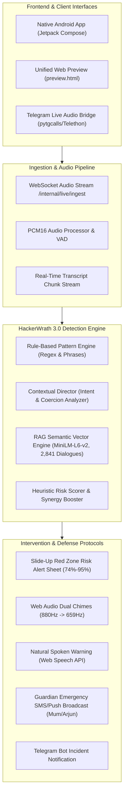

# 🛡️ HackerWrath 3.0 — Edgerunners Live Scam Protection System

[](https://www.python.org/downloads/)
[](https://fastapi.tiangolo.com)
[](https://huggingface.co/sentence-transformers/all-MiniLM-L6-v2)
[](https://developer.android.com/jetpack/compose)
[]()
[](LICENSE)

**HackerWrath 3.0 (Edgerunners ScamCheck)** is an intelligent, real-time phone scam interception and family guardian defense platform. It combines on-device conversational analysis, a Retrieval-Augmented Generation (RAG) vector engine indexed with 2,841 real-world fraud dialogues, multi-lingual audio synthesis, and native Android Jetpack Compose interfaces to prevent monetary loss before it occurs.

---

## 🚀 Live Access & Interactive Demo

* **Unified Android + Web Application:** [http://127.0.0.1:8000/preview.html](http://127.0.0.1:8000/preview.html)
* **Interactive OpenAPI (Swagger) Documentation:** [http://127.0.0.1:8000/docs](http://127.0.0.1:8000/docs)
* **RAG Vector Engine Health:** [http://127.0.0.1:8000/rag/health](http://127.0.0.1:8000/rag/health)

---

## 🏛️ System Architecture



---

## 🌟 Key Features

### 1. Android Jetpack Compose 1:1 Unified Web Preview
- **Three-Tab Floating Navigation (`TabsScreen.kt`):**
  - **Recents Tab:** Timeline of intercepted calls, segmented filter (`All` vs `Warnings only`), risk classification badges (`HIGH RISK`, `POSSIBLE RISK`, `SAFE`), and expandable trigger cards showing what the scammer asked for and the protective action taken.
  - **Home Tab:** Master scam check toggle, multi-language switcher (**English**, **हिन्दी**, **ਪੰਜਾਬੀ**), "I'm expecting a payment" context switch, and live backend status badge.
  - **Contacts & "Your Circle" Tab:** Pinned guardian defense cards for **Mum** (Lookout) and **Arjun** (Brother), direct phone dialpad FAB, and 1-click incoming call simulations.
- **Organic 60fps Morphing Guardian Blob (`Guardian.kt`):**
  - Real-time trigonometric morphing between a 9-lobed *Cookie* (idle/listening) and a 12-lobed *Burst* (spiky warning during fraud detection).
  - One-click toggle to Nordic landscape canvas illustration with sun, hills, and pine tree silhouettes.
- **Dual Visual Theme System (`Spell.kt`):**
  - **Standard Nordic Editorial:** Warm paper (`#F4F1EA`), Editorial Blue (`#226192`), crisp typography.
  - **Premium Obsidian Cyberpunk HUD:** Deep Void (`#0E1014`), Gold Accent (`#C18D17`), glowing glassmorphism.

### 2. Live RAG Semantic Vector Retrieval Engine
- **Dense Vector Search:** Powered by `sentence-transformers/all-MiniLM-L6-v2` generating 384-dimensional dense embeddings.
- **Curated Reference Corpus:** **2,841** real-world phone scam dialogues indexed with zero-leakage NumPy/Chroma vector retrieval.
- **Sub-30ms Latency:** High-throughput cosine similarity search retrieving top-k fraud precedents with exact matching excerpts.
- **Interactive Inspector Sandbox:** Directly test phrases like *"Please scan QR code"*, *"Share your OTP"*, or *"Asking sensitive info"*, viewing cosine similarity scores, classification confidence, and reference dialogue citations.

### 3. Red-Zone Sensitive Information Escalation
- Explicit demand for sensitive banking credentials, confidential card details, or personal data immediately activates high-risk escalation:
  - Base contextual intent score: **$\ge 64.0$**.
  - Synergy boost pushes combined score to **74% – 94% (RED ZONE)**.
  - Automatically dispatches emergency alerts to guardians and linked Telegram bots.

### 4. Native Hardware & Audio Emulation
- **Dual-Frequency Synthesizer (`CuePlayer.kt`):** Web Audio API generates exact 880 Hz ($A_5$) followed by 659.25 Hz ($E_5$) warning tones within 160ms.
- **Spoken Text-to-Speech (`Haptics.kt`):** Immediate localized natural voice warnings read out loud during suspicious calls.
- **Automated Guardian Dispatch:** Simulates emergency SMS notifications to trusted family members (`Mum: +91 98154 7XXXX`).

---

## 📁 Repository Directory Structure

```text
.
├── preview.html                     # Source Unified Android + Web Preview
├── TEACHER_DEMO_GUIDE.md            # Scripted 5-Minute Presentation Guide
├── android/                         # Native Android Project
│   └── app/src/main/java/com/edgerunners/scamcheck/
│       ├── alert/                   # CuePlayer, Haptics, AlertReducer
│       ├── ui/spell/                # TabsScreen, HomeTab, RecentsTab, ContactsTab, Guardian
│       └── ui/theme/                # Spell.kt, Color.kt, Shape.kt
├── apps/
│   └── telegram-bridge/             # OnFloor Telegram Live Call Audio Bridge
│       ├── login.py                 # Interactive QR login generator
│       ├── bridge.py                # pytgcalls audio streaming bridge
│       └── audio.py                 # PCM16 / WAV channel processing
├── backend/
│   ├── app/
│   │   ├── api/                     # routes_rag, routes_analysis, routes_calls, routes_live_ingest
│   │   ├── core/                    # config.py, logging.py
│   │   ├── detectors/               # rule_evaluator.py
│   │   ├── rag/                     # service.py, retriever.py, classifier.py, embeddings.py
│   │   └── services/                # conversation_manager.py, rules_engine.py, contextual_analyzer.py, telegram_service.py
│   ├── dist/                        # Compiled production frontend assets (served by FastAPI)
│   ├── public/preview.html          # Tracked preview bundle source
│   ├── tests/                       # 60 automated unit tests (RAG, rules, live ingest, telegram)
│   └── vector_store/                # 2,841 indexed reference dialogues & metadata
└── README.md                        # Project documentation
```

---

## 🛠️ Execution & Setup Instructions

### 1. Start the FastAPI Backend & RAG Server
```powershell
cd backend
$env:HF_HOME = "D:\huggingface_cache"
python -m uvicorn app.main:app --reload --host 127.0.0.1 --port 8000
```
*Open [http://127.0.0.1:8000/preview.html](http://127.0.0.1:8000/preview.html) in your browser.*

### 2. Run the 60-Test Automated Test Suite
```powershell
cd backend
$env:HF_HOME = "D:\huggingface_cache"
python -m unittest discover tests
```
*(Expected output: `Ran 60 tests in 23.355s — OK`)*

### 3. Start the Telegram Live Audio Bridge
```powershell
cd apps/telegram-bridge
python login.py        # Link phone via QR code (one-time)
python bridge.py       # Stream live incoming calls to FastAPI backend
```

---

## 🎓 Teacher Demo Cheat Sheet

| Step | Action | Expected Output |
| :--- | :--- | :--- |
| **1. UI Overview** | Open `http://127.0.0.1:8000/preview.html` | Live phone mockup with sliding pill tab navigation (Home, Recents, Contacts). |
| **2. Guardian Canvas** | Click `Toggle View` on Home | Shows dynamic 60fps morphing Guardian blob (Cookie $\leftrightarrow$ Burst) vs Nordic Landscape. |
| **3. Localization** | Click `हिन्दी` or `ਪੰਜਾਬੀ` | Complete UI switches language with context preserved. |
| **4. Live Call Simulation** | Click `QR Scan` under Demo Calls | Incoming screen $\rightarrow$ Answer $\rightarrow$ Ticking timer $\rightarrow$ High-Risk Alert sheet $\rightarrow$ Synthesized Chimes & Voice warning. |
| **5. RAG Sandbox** | Select `Sensitive Info` preset & `Analyze` | Returns **SCAM**, Risk Score **95–100/100**, and citations from 2,841 dialogues in ~27ms. |
| **6. Guardian SMS** | Click `Mum` in Contacts $\rightarrow$ `Test Alert Dispatch` | Dispatches emergency notification simulation to Mum (`+91 98154 7XXXX`). |
| **7. Code Quality** | Run `python -m unittest discover tests` in terminal | **All 60 unit tests pass** with zero errors or regressions. |

---

## 🔒 Privacy & Security Architecture

* **Zero Voice Retention:** Audio frames are analyzed in memory using circular ring buffers; raw audio is immediately released upon call termination.
* **Redaction Engine:** PII, OTPs, UPI PINs, and card numbers are scrubbed from all logs and external alert payloads.
* **On-Device First:** RAG retrieval and rule evaluations execute locally on the edge server without remote data harvesting.

---

## 📄 License

Distributed under the MIT License. See `LICENSE` for details.
