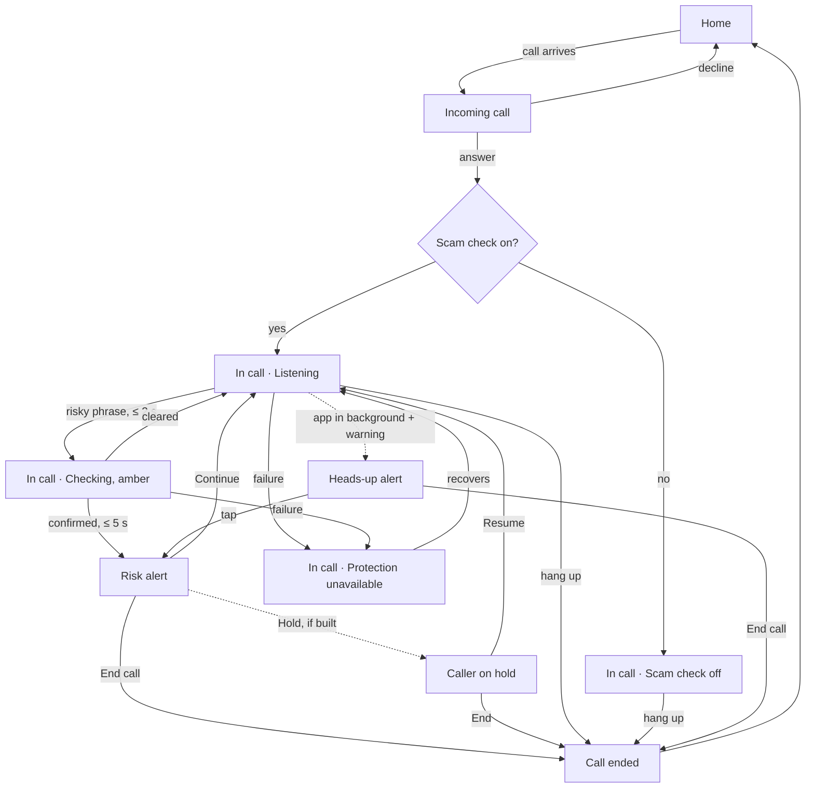

# Edgerunners Live Scam Protection: Screens and flows

How the protected user's app behaves, screen by screen. The look comes from the theme files (`ui/theme/`) and the clickable prototype. Requirement numbers (R2, A11…) refer to *Edgerunners-Scam-Protection-Requirements-v2.0*.

**One app, one user, one journey.** The caller has no screens.

## Screens
| Screen | Purpose | Reached from |
|---|---|---|
| Sign-in | Demo account sign-in | First launch; session expired |
| Home | Scam check switch, language (English, हिन्दी, ਪੰਜਾਬੀ), "I'm expecting a payment" | After sign-in; after a call |
| Incoming call | Answer or decline; shows whether scam check is on | Twilio incoming call |
| In call | Call controls + monitoring status (Listening / Checking / Unavailable / Off) | Answer |
| Risk alert | Full alert at Possible or High risk | Confirmed warning during a call |
| Heads-up alert | Short alert over other apps, with End call | Warning while the app is in the background |
| Call ended | Confirmation, back to Home | Either side hangs up |
| Caller on hold (if built) | Private guidance while the caller is held; Resume / End | "Hold" from the alert (R15) |

Navigation: Sign-in → Home (root). Incoming call and In call come from the call flow; the Risk alert sits over In call; Call ended returns to Home. No tabs, no drawer.

## The journey

## States, screen by screen
| Screen | State | What the user sees | Actions |
|---|---|---|---|
| Sign-in | Error | "Couldn't sign in. Check the details and try again." | Sign in |
| Home | Scam check on | Shield, "Protection during your calls", big switch on, "Scam check is on for your calls" | Toggle, language, payment context |
| Home | Scam check off | Switch off, "Scam check is off. Calls won't be checked." (neutral grey, not red) | Toggle on |
| Home | Save failed | Switch reverts, "Couldn't save. Try again." | Retry |
| Incoming call | Ringing | Number, "Unknown number", "Scam check on" or "Scam check off" | Answer, Decline |
| In call | Starting | "Scam check starting…" (grey) | Mute, Speaker, End |
| In call | Listening | "Scam check on · Listening", calm blue waveform | Mute, Speaker, End |
| In call | Checking | Soft amber panel, warning triangle, "Checking a payment request…"; chime + three long buzzes | Mute, Speaker, End (still usable) |
| In call | Unavailable | Neutral banner with info icon: "Protection unavailable right now. Be careful with any payment request." | Mute, Speaker, End |
| In call | Scam check off | "Scam check off" (grey) | Mute, Speaker, End |
| In call | After Continue | Listening + small line "You chose to continue" | — |
| Risk alert | Possible risk | Amber header with triangle, "Possible risk", what was asked, why it matters, one next step, **End call** (big) / Continue, "Automatic check", "Spoken warning playing" | End call, Continue (+ Report, Hold if built) |
| Risk alert | High risk | Red header with octagon, "High risk", same structure | Same |
| Risk alert | Updated | Same alert refreshed for a repeated request, no new chime | Same |
| Risk alert | Caller hung up | Replaced by Call ended: "The caller ended the call" | Done |
| Heads-up | Shown | Title + one line + End call | Tap → Risk alert; End call |
| Call ended | Ended | "Call ended" (+ "Reported" if used) | Back to home |
| Caller on hold | Holding | "The caller is on hold", guidance playing | Resume, End call |

No screen ever shows "safe", "verified", "all clear" or anything green.

## Interaction rules
- **End call is one tap**, never behind a confirmation; on the alert it's the largest control, pinned to the bottom, still visible at 200% text (the content above it scrolls).
- **Amber never blocks the call controls.** Only the confirmed Risk alert takes over the screen.
- **A cleared check returns quietly to Listening.** No message, no colour change beyond going back to neutral.
- **Repeated requests update the open alert**; no second chime within 20 s.
- **Sounds and haptics play on the user's phone only**: chime and three long buzzes on Checking; spoken warning on Possible/High. The call is muted while a cue plays, then restored to whatever mute state it had.
- **Language** chosen on Home drives every screen and the spoken clip.
- **Unavailable is neutral** (grey/blue info), not red: it's a status, not a threat.
- **Status pairs colour with icon and words:** Listening = waveform + "Listening"; Checking = triangle + amber + words; High = octagon + red + words; Unavailable = info circle + words.

## Edge cases
| Case | Behavior |
|---|---|
| Phone at the ear | Chime, buzzes and spoken warning carry the message; when the phone leaves the ear, the alert is on screen (if built, R13) |
| User in the UPI app | Heads-up alert with End call; tapping opens the Risk alert |
| Protection fails mid-call | Unavailable banner within 10 s; the call continues; back to Listening when it recovers |
| Caller hangs up during an alert | "The caller ended the call" |
| 200% font size | Alert content scrolls; End call stays pinned |
| Hindi/Punjabi copy is longer | Layouts sized for the longest version; titles never truncated |
| User already muted when a cue plays | Mute state restored to what it was |
| Scam check off at answer | "Scam check off" shown; nothing analysed |

## Reusable components
`StatusLine` (listening / checking / unavailable / off) · `AlertCard` (possible / high) · `CallControlBar` (mute / speaker / end) · `BigSwitchRow` · `LanguageChips` · `EndCallButton` (primary, red) · `InfoBanner` (unavailable).
